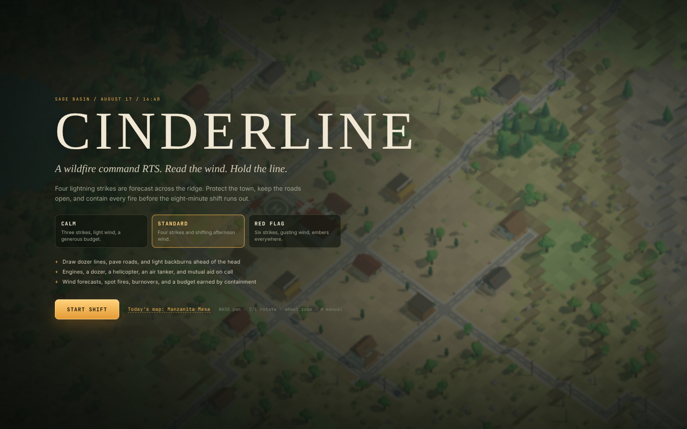
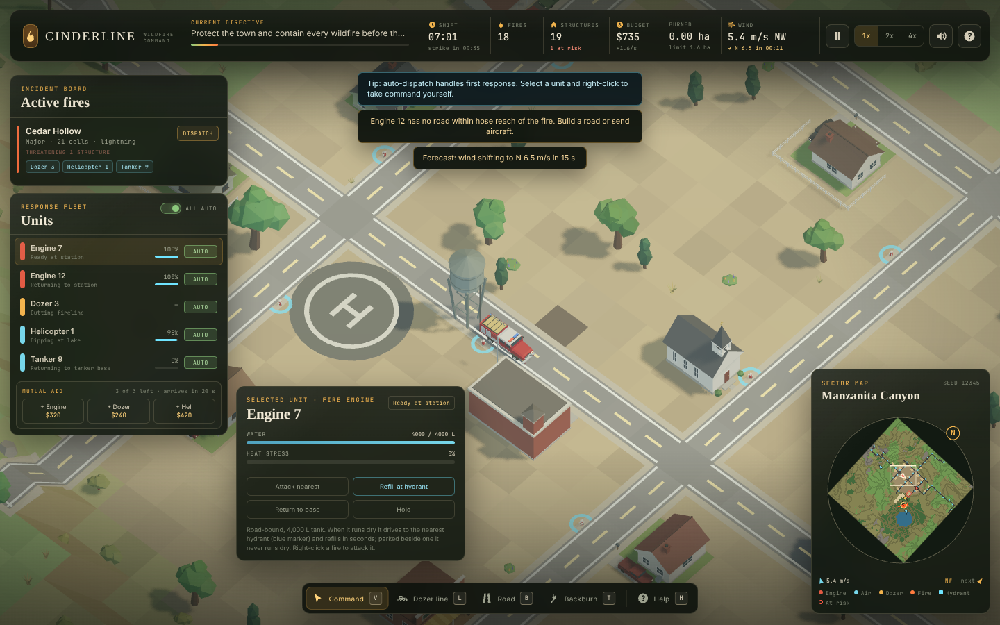
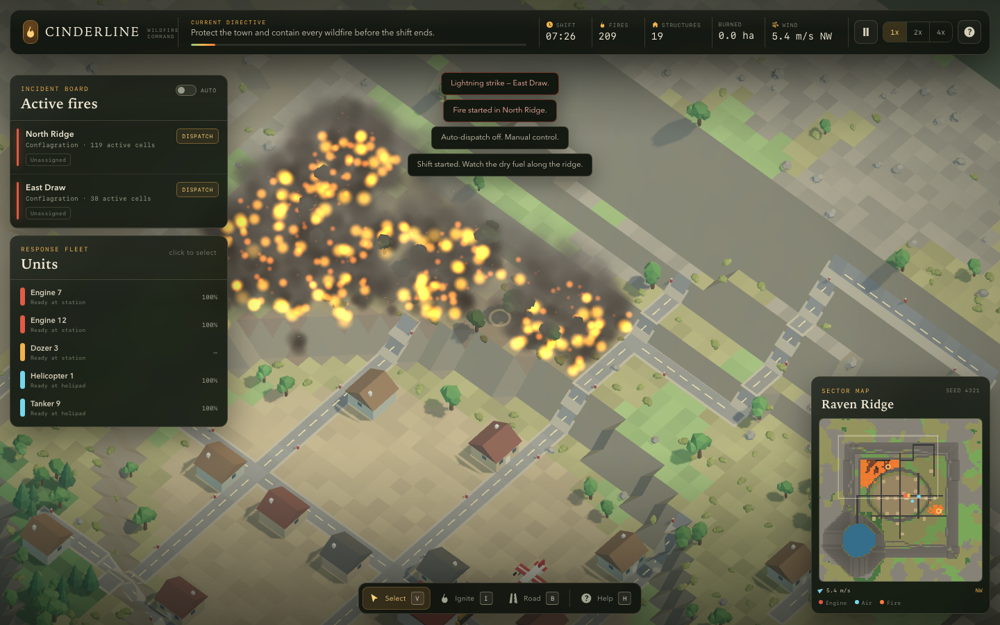
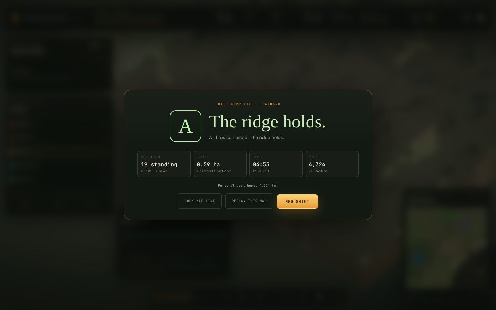

# Cinderline

A low-poly wildfire command RTS that runs in the browser. Read the wind forecast, cut dozer lines across the head of the fire, pave firebreak roads, light backburns, call in mutual aid, and hold the ridge for one eight-minute shift.





| Large fire | Victory |
| --- | --- |
|  |  |

## The game

Cinderline is a from-scratch reboot of the wildfire RTS prototype. The world is a rigid, terraced landscape: every surface is flat or a 45-degree slope, inspired by isometric management games. Fire is simulated per tile with wind, slope, moisture, fuel, spotting, water, retardant, bulldozed firelines, and controlled backburns.

One seeded shift includes:

- **Three difficulty presets.** Calm, Standard, and Red Flag change the number of lightning strikes (3, 4, or 6), wind, fire spread, ember spotting, budget, loss limits, and the score multiplier.
- **A storm and a forecast.** The top bar counts down to the next strike and shows the next wind shift, with a warning 15 seconds before it arrives.
- **Five response units**: two fire engines, a bulldozer, a helicopter, and an air tanker, plus up to three mutual-aid units you can buy mid-shift.
- **Command tools.** Draw dozer lines across the head, pave roads that become firebreaks and bring hydrants, and light backburns against a firebreak to starve the fire of fuel.
- **A command budget.** Income every second, a bonus for every contained incident and every structure that comes through a threat. Spend it on roads, backburns, and mutual aid.
- **Things that go wrong.** Ember spot fires (the lookout opens new incidents for them), wind shifts that swing the head toward town, backburns that run too far and turn wild, and dozers caught in a burnover.
- **Feedback.** Pulsing rings under threatened structures, arrows at each fire's head, lightning bolts and thunder, procedural audio, "your line is holding" reports, a sun that sinks toward golden hour, and smoke that thickens the sky.
- **Grades and personal bests** per map and difficulty, with a one-click replay of the same map.

## Run it

```bash
npm install
npm run dev
```

Open the printed local URL (default `http://localhost:5173`). Add `?seed=12345` to replay a specific world and `&difficulty=redflag` to preselect a preset.

Production build:

```bash
npm run build
npm run preview
```

## Controls

| Input | Action |
| --- | --- |
| Left click | Select a unit, use the active tool, or send the selected unit at a burning tile |
| Right click | Move the selected unit / aircraft, or attack a burning tile |
| V | Command (select) tool |
| L | Dozer line: click the start, then the end |
| B | Road: click the start, then the destination ($4 per new tile) |
| T | Backburn torch ($20): click fuel beside a road, line, or burned ground |
| Tab / Shift+Tab | Cycle units; click a selected unit's card again to centre on it |
| WASD / arrows | Pan |
| Q / E | Rotate |
| R / F | Tilt |
| Mouse wheel | Zoom toward cursor |
| Middle drag | Pan |
| Space | Pause / resume |
| 1 / 2 / 4 | Simulation speed |
| M | Mute / unmute |
| H | Field manual |
| Escape | Cancel a pending start point, leave the tool, close help, or deselect |

## Systems

- **Terrain**: 96×96 tiles at 2 m per tile. Every seed generates a new map: rolling fractal hills quantized to terraces (flat tops, 45-degree faces), with the town, lake, highways and lookout road placed per seed. Roads are graded into clean ramps; banks keep their vegetation and show earth strata.
- **Fire**: deterministic per-tile state machine at 5 Hz. Wind and upslope increase rate-of-spread; moisture, wetness, and retardant reduce it. Spotting throws embers downwind. Roads and cleared firelines are barriers. Backburns stay under control for ten tiles of spread before they turn wild. Structures accumulate damage while their tiles burn.
- **Units**: engines are road-bound, carry 4,000 L, and park on a road tile within hose reach of the fire (beside a hydrant when they can). Dozers leave the road, route around flames, cut permanent lines, and stop if the fire reaches the line. The helicopter drops on the downwind head and dips from the lake when it is closer than the helipad. The tanker lays a perpendicular retardant line. Ground crews standing in flames suffer a burnover and are out of service for 25 s.
- **Dispatch**: incidents track severity, threatened structures, and assigned units. Auto-dispatch sends the best available ground unit, aircraft, or dozer, and only sends engines to fires they can reach. A lookout opens incidents for untracked spot fires. Manual dispatch and direct orders override it.
- **Hydrants**: spaced along the road mask, rebuilt after road edits. An engine within 4.6 m of a hydrant gets a visible unlimited feed.
- **Simulation clock**: gameplay advances in fixed 1/30 s steps, so a seed plays out the same at 1×, 2×, or 4×.
- **Rendering and audio**: Three.js orthographic diorama camera, flat-shaded terraced terrain, instanced vegetation and particles, a terrain-hugging plan preview for roads and lines, and procedural WebAudio (no audio files).

## Quality gates

```bash
npm run typecheck   # strict TypeScript
npm test            # Vitest: terrain, roads, biomes, fire, hydrants, units, mechanics
npm run build       # typecheck + production bundle
npm run check       # typecheck + tests + build
npm run smoke       # Playwright browser smoke test
npm run stability   # five-seed full shift, plus a determinism replay
npm run balance     # hands-off outcomes per seed; fails on stuck units
```

`npm run balance` accepts `SEEDS=1,2,3`, `DIFFICULTY=calm|standard|redflag`, and `PORT=4178`.

The smoke test boots the game, starts a shift, ignites a fire, selects and moves an engine, builds a road, checks firebreak integration, verifies pause/help/speed controls, fast-forwards to an outcome, and asserts the end screen appears without browser errors.

Browser scripts use Playwright's Chromium when it is installed (`npx playwright install chromium`). Otherwise they fall back to a system Chrome or Chromium, or to the binary named in `CHROMIUM_PATH`.

## Project layout

```text
src/
  core/      renderer, scene, orthographic camera rig, math, RNG, preferences
  world/     terraced heightmap, biomes, roads, buildings, vegetation, hydrants
  sim/       fire model, particles, units, incidents, scenario, difficulty, budget
  fx/        lightning, threat rings, head arrows, plan preview, sunset atmosphere
  audio/     procedural sound engine
  ui/        HUD, minimap, notifications, start/end screens, tool chrome, hints
  test/      headless world/fleet harness for unit tests
  game.ts    game orchestration and input
  main.ts    browser entry point
specs/       living architecture, world, fire, units, and gameplay specs
scripts/     browser smoke, stability, and balance checks
```

## Status

Version 1.1 adds the command layer (budget, dozer lines, backburns, mutual aid), difficulty presets, forecasts, threat feedback, audio, and grading on top of the v1.0 MVP. Scenario persistence, multiplayer, additional scenarios, and mobile-specific controls are out of scope for this version. See [specs/architecture.md](specs/architecture.md) for the current module map and [specs/gameplay.md](specs/gameplay.md) for the gameplay contract.

## License

Private and proprietary.
